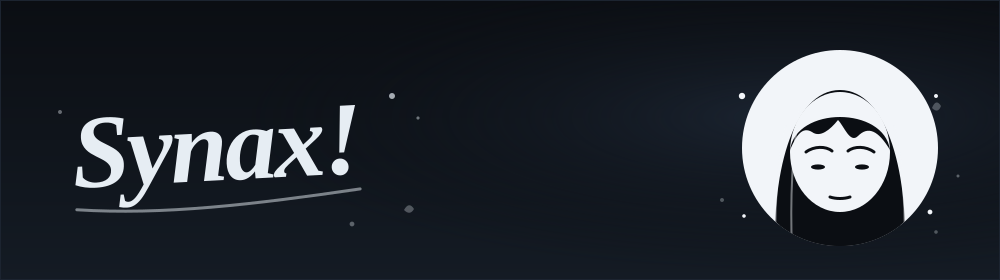

<div align="center">
  
</div>

<div align="center">
  <a href="https://git.io/typing-svg">
    
  </a>
</div>

<div align="center">
  
</div>

<div align="center">
  
  
  
</div>

<br />

## `~ whoami`

```sql
SELECT
    name,
    role,
    location,
    currently_learning
FROM engineers
WHERE handle = 's9ss';
```

| Field | Value |
| :-- | :-- |
| **Name** | Saud AL-Mutairi |
| **Role** | CS Student · SQL AI Engineer |
| **Location** | Riyadh, Saudi Arabia · UTC+3 |
| **Focus** | Databases, LLM-assisted data tooling, query intelligence |
| **Learning** | Vector search, query optimization, applied ML |
| **Reach me** | Open an issue, or find me on the links below |

<br />

## `~ stack`

<div align="center">

**Languages**


**Data & AI**


**Tooling**


</div>

<br />

## `~ stats`

<div align="center">
  
  
</div>

<div align="center">
  
</div>

<div align="center">
  
</div>

<div align="center">
  
</div>

<br />

## `~ the snake`

<div align="center">
  <picture>
    <source media="(prefers-color-scheme: dark)" srcset="https://raw.githubusercontent.com/s9ss/s9ss/output/github-contribution-grid-snake-dark.svg" />
    <source media="(prefers-color-scheme: light)" srcset="https://raw.githubusercontent.com/s9ss/s9ss/output/github-contribution-grid-snake.svg" />
    
  </picture>
</div>

<br />

## `~ currently`

```yaml
building:    tooling that makes SQL feel like a conversation
reading:     query planners, vector indexes, papers I should've read sooner
open_to:     collabs on data + AI, anything with a schema
philosophy:  ship small, ship often, ship green
```

<br />

<div align="center">
  <a href="https://github.com/s9ss"></a>
  
  
</div>

<br />

<div align="center">
  
</div>
